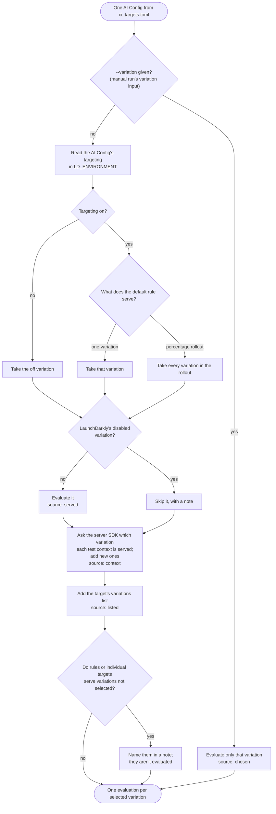

# CI evals: the LaunchDarkly evals GitHub Action

`.github/workflows/evals.yml` runs `ci_eval.py` in GitHub Actions. It evaluates the AI Config variations the agents
use against datasets stored in LaunchDarkly, and reports the results in the job summary and on the PR. Results are
advisory: failing rows never block a merge.

## What triggers it

| Trigger | When | Datasets |
|---|---|---|
| Pull request | A PR into any branch changes one of the files below | quick |
| Push to `main` | A merge or push to `main` changes one of the files below | quick |
| Schedule | Nightly at 09:00 UTC | full |
| Manual | **Actions > LaunchDarkly evals > Run workflow** | quick, or full if you tick **full** |

The PR and push triggers only fire when the change touches one of these paths:

- `app/backend/src/agents/**`: the agent code
- `infrastructure/launchdarkly/ai_configs_resources.tf`: AI Config prompts, variations and judges
- `infrastructure/launchdarkly/model_configs.tf`: model definitions
- `evals/ci_eval.py`, `evals/ci_targets.toml`, `evals/pyproject.toml`, `evals/uv.lock`: the eval runner and its setup
- `.github/workflows/evals.yml`: the workflow itself

For a PR, GitHub matches these paths against the PR's whole diff, not only the latest commit. Once a PR touches one of
them, every later push to that PR runs the evals again. A new push cancels a PR's run that is still going. Push,
nightly and manual runs each have their own queue, so a push to `main` doesn't cancel the nightly run.

It doesn't run:

- **On PRs from forks.** They get no secrets or AWS credentials.
- **When an AI Config changes in the LaunchDarkly UI.** Edits made there instead of through Terraform show up in the
  next nightly run. A trigger for those changes is planned (#19).

Manual runs take three optional inputs:

- **config**: evaluate one AI Config, for example `brand_agent`. Leave it blank for every target.
- **variation**: evaluate one variation key. Leave it blank for the variation each config serves.
- **full**: use the full datasets.

## What a run does

1. **Signs in to AWS** through GitHub's OIDC token, assuming the role in `AWS_ROLE_ARN`. The models run on Bedrock in
   that AWS account.
2. **Installs** the evals project with `uv sync --locked`.
3. **Downloads the latest results from `main`.** That's the newest unexpired `eval-results-quick` or
   `eval-results-full` artifact from a run on `main`. If there isn't one yet, the comparison column says "not on
   `main`".
4. **Runs `ci_eval.py`** for every target in `ci_targets.toml`, or the chosen config:
   - **Picks the variations.** It reads the AI Config's targeting in `LD_ENVIRONMENT` and evaluates the variation the
     default rule serves, or each variation in a percentage rollout. It then asks LaunchDarkly which variation each
     test context in `ci_targets.toml` is served (for example `employee`) and evaluates those too, so variations that
     targeting rules or individual targets serve are tested without being listed. A target's `variations` list adds
     more, and the manual **variation** input picks one instead.
   - **Generates a response for each row.** The LaunchDarkly AI SDK reads the variation's model and prompt and
     generates on Bedrock. The app doesn't need to be running.
   - **Scores each row.** Triage checks whether the reply would route to the expected specialist. The other agents are
     scored by the `ci-judge-accuracy` and `ci-judge-coherence` judges against each target's threshold.
   - **Compares with `main`.** It matches rows to the downloaded results and lists the ones that newly fail and the
     ones that now pass.
5. **Reports the results:**
   - **Job summary:** a table per config and variation with rows passed, the comparison with `main`, and a verdict,
     followed by the failing rows with the judge's score and reason.
   - **PR comment:** the same summary in one comment, which later runs update in place.
   - **Results artifact:** the `eval-results-quick` or `eval-results-full` JSON, kept for 90 days. The artifacts from
     runs on `main` are what later runs compare with.

The job fails only when a target can't run at all, for example from an API error or a missing dataset. Rows that
fail the eval show as "failed" in the summary but leave the job green.

The repository is public, so the workflow passes `--no-run-links`. The summary gives each LaunchDarkly evaluation run
by name instead of linking to it. Find a run in LaunchDarkly under **Evaluations** by that name.

### How the variations are chosen

> This diagram only illustrates how variations are chosen today. The rules are still open to change.

For each AI Config, `select_variations` in `ci_eval.py` decides which variations to evaluate:



The source (*served*, *context*, *listed* or *chosen*) appears next to each variation in the summary table, and the
**Served to** column names the test contexts LaunchDarkly serves it to and why, for example `employee (rule 1)`.

### Test contexts

`[contexts]` in `ci_targets.toml` holds named test contexts with the attributes the app sends: `customer` and
`employee` (the app's two demo logins) and `customer-bronze` and `customer-platinum` (plan tiers). For each target,
`ci_eval.py` evaluates the AI Config for each context with the LaunchDarkly server SDK, as the app does, and evaluates
every distinct variation they reach. So when a rule such as `role is one of employee` serves a variation, CI evaluates
it with no change to `ci_targets.toml`.

- A context chooses the variation only. Its attributes don't reach the prompt; prompt variables come from each
  dataset row.
- The variation runs on the target's normal dataset, so its results compare with the default variation's.
- Eval runs are per distinct variation, so a context served a variation already selected costs one SDK evaluation
  and no model calls.
- A target can limit its contexts with `contexts = ["employee"]`, or turn them off with `contexts = []`.
  `--no-contexts` turns them off for one run, and `--variation` ignores them.
- The SDK client sends no events, so test contexts don't appear in LaunchDarkly. `ci_eval.py` checks that
  `LD_SDK_KEY` is the SDK key of `LD_ENVIRONMENT` before it evaluates any context.

If targeting serves a variation no test context reaches, the summary names it. Add a context that matches the rule,
or add the variation to the target's `variations` list. The AI Config targeting API doesn't return the variation a
rule serves (JeremyDarkly/policy_agent#33), so that note reads rules from the flags API; if that read fails, the note
says so.

## End-to-end evals

`.github/workflows/e2e-evals.yml` runs `ci_eval.py --e2e`. It starts the backend in the runner and sends each row of
the triage datasets to `/api/chat`, so the real graph answers it: triage, then a specialist (or nothing, for a general
question), then brand voice. It uses the `[e2e]` target in `ci_targets.toml` and reports in its own PR comment.

| Trigger | When | Dataset |
|---|---|---|
| Pull request, push to `main` | The change touches `app/backend/**` (except `app/backend/tests/**`), `evals/ci_eval.py`, `evals/ci_targets.toml`, `evals/pyproject.toml`, `evals/uv.lock` or the workflow file | `triage_routing_dataset_quick` (12 rows) |
| Schedule | Nightly at 09:30 UTC, after the config-level run | `triage_routing_dataset` (48 rows) |
| Manual | **Actions > LaunchDarkly end-to-end evals > Run workflow** | quick, or full if you tick **full** |

Each row is scored on:

- **`e2e-routed`**: the specialist the graph ran matches the row's `expected_specialist`. A general question passes
  only if triage sent it straight to brand voice.
- **`e2e-handoff`**: the route is complete (triage, at most one specialist, brand voice) and the reply isn't empty.
  A row where the backend set `error` counts as an error row.
- **`e2e-slots-offered`**: for scheduler rows, every slot ID in the reply is one the scheduler was given. Only the
  date-time digits are compared, since models sometimes drop the `SLOT-` prefix. Those IDs are listed as malformed
  in the summary, not failed.
- **`ci-judge-accuracy`**: brand voice's reply keeps the facts in the specialist's draft and adds none that are in
  neither the draft nor the customer profile brand voice was sent. The handler records the profile and the draft as
  `customer_profile` and `specialist_draft` tool calls, which the judge reads in `{{message_history}}`. The AI SDK
  has no supported way to give a judge data the generation produced (#40), so the run's trajectory shows these
  calls even though no agent made them.

The summary lists the failing rows, the route and the variation and model each agent served per row, malformed slot
IDs, and the run's time, agent generations and judge calls. The results compare with the latest `main` results, as
the config-level ones do, from the `e2e-results-quick` and `e2e-results-full` artifacts.

How a run differs from the config-level one:

| | Config-level (`evals.yml`) | End-to-end (`e2e-evals.yml`) |
|---|---|---|
| What answers a row | One variation, through the AI SDK | The running backend, all agents |
| Which variation | Each one the default rule or a test context is served | Whatever the backend is served for one context (`customer`) |
| Catches | A variation's prompt or model getting worse | Routing and handoff bugs in `src/graph/`, prompt building in `src/utils/`, brand voice inventing facts from the real draft and profile |
| Misses | Wiring between agents; the app's own prompt building | Variations no request reaches; agents' scores on their own |
| Cost of a quick run | Depends on the targets | About 2 minutes, 33 generations and 12 judge calls |

The backend starts with `python server.py` and the session credentials from the AWS step, not `docker compose`, which
mounts `~/.aws`. It uses `LD_ENVIRONMENT`, the same environment as the config-level run, so it sees the targeting
that run evaluates. Each request sends:

- `userKey` `ci-e2e-customer` and the attributes of `[contexts.customer]`
- `conversationId` `ci-e2e-<label>`
- `includeTrace: true`, which adds each agent's variation, model and output to the response
- `onlineJudges: false`, which skips the app's background judges

CI traffic goes to the same Monitoring tabs as the demo. Filter it out by the `ci-e2e-` context key or conversation
ID, or move the job to its own environment if it gets noisy.

If the backend doesn't answer `/health` in 60 seconds, the job fails as a setup error. On any failure the last 200
lines of the backend log are printed to the job log, where GitHub masks secret values. The log isn't uploaded as an
artifact, because it has the LaunchDarkly hostnames and artifacts aren't masked.

To turn end-to-end runs off, disable the workflow under **Actions**, or delete `e2e-evals.yml`. The config-level runs
are unaffected.

## Quick and full datasets

Every target has a full dataset and a quick one (the same key with a `_quick` suffix):

| AI Config | Full | Quick |
|---|---|---|
| `triage_agent` | 48 rows | 12 rows |
| `account_agent`, `branch_agent`, `scheduler_agent`, `brand_agent` | 8 rows each | 3 rows each |

PRs and pushes to `main` use the quick datasets, and the nightly run uses the full ones. LaunchDarkly sets a daily
token limit per member for evaluations, and every generation and judge call counts toward it, even though Bedrock
bills the models to your own AWS account. A full run of every target uses a large share of that limit. Over the limit,
LaunchDarkly rejects new runs with `429 token_limit_exceeded` until the limit resets at 00:00 UTC. An account Admin can
raise or remove the limit under **Settings > Plans and usage**.

Quick and full results are kept as separate artifacts, so each run compares with `main` results from the same
datasets.

## Setup

**Datasets.** Each dataset in `ci_targets.toml` must exist in LaunchDarkly with that key. Upload the matching `.jsonl`
file in the LaunchDarkly UI (**Library > Datasets > New dataset**). The triage datasets are in this folder and the
others are in `ci_datasets/`. Uploading to an existing dataset adds rows rather than replacing them, so create a new
dataset to replace one. `build_specialist_datasets.py` rebuilds the specialist datasets (see [README.md](README.md#ci-evals)).

**Judges.** `ci-judge-accuracy` and `ci-judge-coherence` are AI Configs defined in
`infrastructure/launchdarkly/ai_configs_resources.tf`. Apply them with Terraform before the first run.

**Repository secrets:**

| Secret | What it is |
|---|---|
| `AWS_ROLE_ARN` | An IAM role GitHub can assume through OIDC, allowed to call Bedrock for the models in `infrastructure/launchdarkly/model_configs.tf` |
| `LD_PROJECT_KEY` | The LaunchDarkly project |
| `LD_API_TOKEN` | A LaunchDarkly API access token that can create evaluations and read AI Configs and datasets |
| `LD_SDK_KEY` | The server-side SDK key of `LD_ENVIRONMENT`. Used to evaluate the test contexts. |
| `LD_ENVIRONMENT` | The environment whose targeting decides the served variation |
| `LD_API_BASE_URI`, `LD_UI_BASE_URI`, `LD_BASE_URI`, `LD_STREAM_URI`, `LD_EVENTS_URI` | LaunchDarkly endpoints. Leave them unset for production. |
| `LAUNCHDARKLY_OTLP_ENDPOINT`, `LAUNCHDARKLY_OBSERVABILITY_BACKEND_URL` | End-to-end runs only: the backend's observability endpoints. Leave them unset for production. |

**OIDC trust policy.** The role's trust policy must match the repository's OIDC subject format. Check it with
`gh api repos/<owner>/<repo>/actions/oidc/customization/sub`. If `use_immutable_subject` is true, the subject is
`repo:<owner>@<owner id>/<repo>@<repo id>:...` (the `sub_claim_prefix` it returns), not `repo:<owner>/<repo>:...`.
A trust policy written for the short form fails with "Not authorized to perform sts:AssumeRoleWithWebIdentity". The
role needs to trust both `...:pull_request` (PR runs) and `...:ref:refs/heads/*` (push, nightly and manual runs).

## Running it locally

The same script runs from this folder with an env file:

```sh
uv run python ci_eval.py --env-file ../.env.staging-org --quick
uv run python ci_eval.py --env-file ../.env.staging-org --config brand_agent --variation default
```

For an end-to-end run, start the backend first (`cd app/backend && python server.py`), then:

```sh
uv run python ci_eval.py --env-file ../.env.staging-org --e2e --quick
```

Set `POLICY_AGENT_URL` if the backend isn't on `http://localhost:8000`.

Local runs use your own AWS credentials and LaunchDarkly token, and count toward your own daily evaluation token limit.

## Troubleshooting

- **`429 token_limit_exceeded`**: the daily evaluation token limit is used up. Wait for the reset at 00:00 UTC, or
  ask an Admin to raise the limit. Bedrock throttling shows up differently, as a `ThrottlingException` from AWS.
- **"Not authorized to perform sts:AssumeRoleWithWebIdentity"**: the role's trust policy doesn't match the OIDC
  subject. See **OIDC trust policy** above.
- **A dataset shows as empty after upload**: a row is too long for the upload screen (about 4,096 characters).
- **Generation errors on a row**: the summary lists them under row errors. A model can reject a parameter combination
  that the backend never sends. Use `drop_parameters` in `ci_targets.toml` to leave those parameters out.
