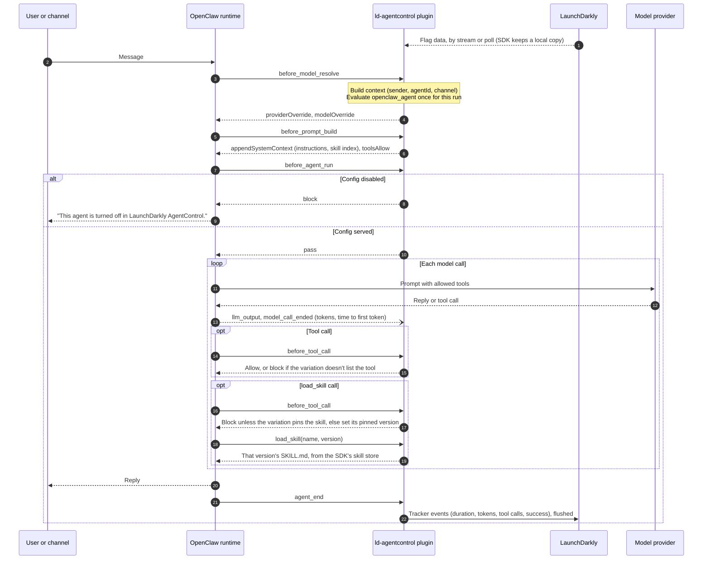

# AgentControl runtime control for OpenClaw agents

An [OpenClaw](https://docs.openclaw.ai) plugin that takes each agent run's model, instructions, tools and skills
from a LaunchDarkly AgentControl config, and records the run's tokens, duration and outcome on that config. Changes made in
LaunchDarkly apply to the next run, with no redeploy and no OpenClaw restart. [PLAN.md](PLAN.md) explains the design
and what was tested.

| File | What it is |
|---|---|
| `plugin/` | The OpenClaw plugin (`index.ts`) and its manifest |
| `skills/` | The library skills, one folder per version: `skills/<key>/<version>/SKILL.md` |
| `setup_config.py` | Creates the `openclaw_agent` config, its tools, skills, variations and targeting. Also the kill switch, instruction edits and skill versions the checks use |
| `run_checks.sh` | Seven checks against real OpenClaw agents and the live config |
| `env.sh` | Exports the variables the checks need from the repo's env file, and points OpenClaw at `.state/` |
| `demo.sh`, `demo_view.py`, `DEMO.md` | A scripted demo for a recording, with its talk track: the expected behavior, then OpenClaw's own skills getting past the variations |

## Before you run it

- **Node** 24.16 or later (or 26.1 or later), for OpenClaw.
- **The env file**: `.env.staging-org` at the repo root by default, set with `ENV_FILE_NAME`. It needs
  `LAUNCHDARKLY_SDK_KEY`, `LAUNCHDARKLY_ACCESS_TOKEN`, `LAUNCHDARKLY_PROJECT_KEY`, `LAUNCHDARKLY_ENVIRONMENT` and
  `OPENAI_API_KEY`.
  - For a non-production LaunchDarkly instance, also set `LAUNCHDARKLY_API_HOST`, `LAUNCHDARKLY_BASE_URI`,
    `LAUNCHDARKLY_STREAM_URI` and `LAUNCHDARKLY_EVENTS_URI`.
  - When `LAUNCHDARKLY_BASE_URI` is set, the plugin polls instead of streaming, as the rest of this repo does.
- **The project's model configs** must include `OpenAI.gpt-5.4-mini` and `OpenAI.gpt-5.4-nano`. OpenClaw refuses
  model ids that aren't in its catalog, such as `gpt-4o-mini`.

## Run it

```sh
cd openclaw
npm install
(cd plugin && npm install)
python3 setup_config.py setup   # safe to rerun
./run_checks.sh                 # or one check: baseline, targeting, tools, live, skills, skillchange, servedmodel, killswitch
```

The first run creates `.state/`, writes an OpenClaw config with two agents (`main` and `helper`), and links the
plugin. OpenClaw never reads or writes `~/.openclaw` here. Every check makes real model calls; a full run takes
about five minutes and makes about 15 runs on the two small models.

To talk to an agent yourself:

```sh
source env.sh
npx openclaw agent --local --agent helper -m "What can you do?"
cat .state/decisions.jsonl     # what each run was served, offered and blocked
```

## What it changes in LaunchDarkly

- Two Library tools: `openclaw_read` and `openclaw_exec`. The plugin strips the `openclaw_` prefix to get OpenClaw's
  tool ids.
- An agent-mode config, `openclaw_agent`, with two variations:
  - `standard`: `gpt-5.4-mini` with both tools.
  - `locked-down`: `gpt-5.4-nano` with no tools.
- Three library skills, tagged `openclaw`. `setup_config.py skill <key> <folder>` publishes another version and
  pins it wherever that skill is used:
  - `openclaw-house-style`: short replies ending in a `Style: house v1` line. Pinned on both variations; v2 ends in
    `Style: house v2`, for the skill-change check.
  - `openclaw-workspace-report`: lists and summarizes the workspace under a `## Workspace report` heading. Pinned on
    `standard`.
  - `openclaw-explain-limits`: what to say when a tool is blocked, starting with `Limit:`. Pinned on `locked-down`.
- Targeting in your environment: `locked-down` for contexts whose `agentId` is `helper`, and `standard` for everyone
  else.

`python3 setup_config.py off` is the kill switch. It serves the config's built-in `disabled` variation to everyone,
because the API can't flip an AI Config's targeting toggle. `on` restores the targeting. The UI toggle works too.

## How the plugin maps AgentControl onto OpenClaw

The plugin runs inside the OpenClaw process. The first hook in a run evaluates the config, and later hooks in that
run reuse the result. The SDK evaluates from its local copy of the flags, so a hook doesn't wait on a network call.
Only events go back to LaunchDarkly.



| AgentControl | OpenClaw hook | Effect |
|---|---|---|
| Config off, or the `disabled` variation | `before_agent_run` | The run is blocked with a message |
| Model and provider | `before_model_resolve` | That run's model. `model.custom.openclawModel` (`provider/model`) overrides the mapping |
| Instructions | `before_prompt_build` | Appended to OpenClaw's system prompt |
| Tools | `before_prompt_build`, `before_tool_call` | Other tools are hidden from the model, and any call to one is blocked |
| Skills | `before_prompt_build`, `before_tool_call`, the `load_skill` tool | Pinned skills are listed in the prompt and loaded on demand; see [Skills](#skills) |
| Tracker | `llm_output`, `model_call_ended`, `agent_end` | Tokens, time to first token, duration, tool calls and success |
| Served model | `agent_end` | `ai-model-served` and `ai-model-mismatch` (1 or 0) for each model call in the run. See below |

OpenClaw's hook events name the model it *requested*. The model the API reported is `responseModel` on each assistant
message in `agent_end`'s messages, so the plugin reads it from there, one entry per model call, as the backend does. Events have the
same data as the backend's (see [Served model](../README.md#served-model)), with `source` set to `response` when the
API named the model and `message_model` when it didn't. Both send `ai-model-mismatch`: a `message_model` that
isn't the variation's model means OpenClaw itself switched models. OpenAI Completions, Mistral and Google only report a model
that differs from the request; CLI-backed runs never do. OpenClaw itself logs a dated snapshot as a "model route
change"; the plugin uses the backend's rule and doesn't count it as a mismatch. Tests: `node --test openclaw/plugin/served_model.test.ts`.

The LaunchDarkly context is a `user` keyed by the sender, or `openclaw-local-operator` for command-line runs. It has
the attributes `agentId`, `channel` and `trigger`.

When LaunchDarkly can't be reached, or the config doesn't exist, runs keep OpenClaw's own settings. Set
`failClosed: true` in the plugin's config to block them instead.

## Skills

A variation pins library skills by key and version. For each run the plugin:

1. Reads the served variation's pins, and fetches each pinned version from the SDK's skill store. The store checks
   each skill's content hash.
2. Adds a short index to the system prompt: each skill's name and description, not its content.
3. Offers its `load_skill` tool. When the model calls it, `before_tool_call` checks the name against the run's pins,
   blocks anything else, and replaces the arguments with the pinned key and version. The tool returns that exact
   version's `SKILL.md`.

Nothing is written to disk. Skill content stays in the SDK's in-memory store, and LaunchDarkly stays the only copy
that matters. Re-pinning, rolling back or unpinning a skill applies on the next run, the same way targeting does.

`load_skill` is allowed for any pinned skill, whatever the variation's tool list says, so `locked-down` can load
skills while it has no other tools. Each load is recorded in the decision log as `skill_loaded`, and a refused one as
`blocked_skill`.

Plugin settings go under `plugins.entries.ld-agentcontrol.config` in the OpenClaw config. They are `configKey`,
`toolPrefix`, `failClosed`, `hideTools`, `initTimeoutSeconds` and `decisionLog`; the manifest describes each one.

## Traces

When the `openclaw-agentcontrol-tracing` flag is on for a run, the plugin exports the run to LaunchDarkly
observability as one trace, linked to the `openclaw_agent` config, so it appears on the config's Monitoring tab next
to the backend's agents. `tracing.ts` builds it from the plugin's hooks:

| Span | From / to | Carries |
| --- | --- | --- |
| `invoke_agent <agentId>` (root) | the run's first hook / `agent_end` | the `feature_flag` event that links the config, `launchdarkly.config.key`, `launchdarkly.variation.key`, `gen_ai.conversation.id` (the session key); `openclaw.blocked_reason` on a blocked run |
| `chat <model>` | `model_call_started` / `model_call_ended` | `gen_ai.provider.name`, `gen_ai.request.model`, `gen_ai.response.model` (the served model), TTFT, error status |
| `execute_tool <name>` | `before_tool_call` / `after_tool_call` | `gen_ai.tool.name`, `gen_ai.tool.call.id`; `openclaw.blocked=true` for a blocked call, `openclaw.skill` for `load_skill` |

Details:
- **Usage is per run.** OpenClaw reports token usage once per run, in `llm_output` after the last model call. So the
  run's total goes on the last `chat` span, marked `openclaw.usage.scope=run`. Per-trace totals are right; the split
  between calls isn't there.
- **The link.** The `feature_flag` event has the same attributes LaunchDarkly's tracing hooks send:
  `feature_flag.key`, `feature_flag.provider.name`, `feature_flag.context.id`, `feature_flag.result.variationIndex`,
  and `feature_flag.set.id` when the SDK reports the environment ID.
- **The Monitoring tab lags.** A trace shows under **Monitor > Traces** at once, and on the config's Monitoring tab
  some minutes later (#30). Runs whose model calls all fail, and blocked runs, show under Traces only (#31).
- **Provider.** The plugin's tracer provider isn't registered globally, so it doesn't clash with `diagnostics-otel` or
  another OpenTelemetry SDK. It uses `env.sh`'s `OTEL_EXPORTER_OTLP_ENDPOINT` and `OTEL_RESOURCE_ATTRIBUTES`
  (`launchdarkly.project_id` set to the SDK key); `OTEL_SERVICE_NAME` replaces the default service name,
  `openclaw-agentcontrol`. For a non-production instance, set `LAUNCHDARKLY_OTLP_HTTP_ENDPOINT`
  in the env file. Without it, `env.sh` sets `OTEL_SDK_DISABLED=true`, which turns tracing off, so the instance's SDK
  key never goes to the production collector.
- **Failures.** Export batches that fail are sent as the `openclaw-trace-export-failed` metric event with the next run
  that finishes.

`setup_config.py setup` creates the flag and metric. When it creates the flag, it turns tracing on for `helper` only;
an existing flag's targeting is left alone, and so is a rollout. To change it:
- `python3 setup_config.py tracing all` traces every run;
- `tracing off` traces none;
- `tracing helper` goes back to the default;
- `tracing` on its own prints the current mode (`custom` for targeting set some other way).

`run_checks.sh` records the mode before it starts and puts it back afterwards. It uses `tracing` in two checks:
- the `tracing` check;
- the kill-switch check, which confirms that a blocked run is still exported.

Both skip that part when the mode is `custom`. A blocked run's trace is finished in `before_agent_run`, since the run
may end without `agent_end`. `trace_load.sh` sends traffic for the flag's guardrails. Command-line
runs all share the context key `openclaw-local-operator`, so a percentage rollout of the flag puts every run in the same
bucket. Roll out by `agentId` rule instead.

OpenClaw's own `diagnostics-otel` stays installed with its trace export off (`"traces": false` in `run_checks.sh`).
Turning it back on adds OpenClaw's unlinked trace alongside the plugin's, with each LLM call counted twice.

## Gaps and unexpected behavior

Found on 2026-10-13 while building and testing this, and on 2026-10-14 while adding skills, with:

- OpenClaw 2026.10.3 on Node 26.9.0
- `@launchdarkly/server-sdk-ai` 2.0.13 and `@launchdarkly/node-server-sdk` 9.14.4
- `@launchdarkly/ai-server` 0.4.0, for its experimental skills module only
- the LaunchDarkly REST API with `LD-API-Version: beta`

Recheck these after upgrading any of them.

### LaunchDarkly AI SDK

- **A missing config looks the same as a disabled one.** For an unknown config key, `agentConfig()` returns the
  default, which is `enabled: false`, and doesn't say why. So a wrong key or environment would turn every agent off.
  - Workaround: when a config comes back disabled, the plugin calls the base SDK's `variationDetail()` and treats
    an `ERROR` reason as "LaunchDarkly unavailable".
  - This is the only place the plugin goes outside the AI SDK. It sends one extra evaluation event when it runs.
- **Metrics have to be recorded by hand when the app doesn't make the model call.** `trackMetricsOf` wraps a call
  the app makes itself. OpenClaw makes the calls here.
  - Workaround: the plugin adds up the usage from OpenClaw's `llm_output` hook and calls `trackTokens`,
    `trackDuration` and the other track methods itself.
  - OpenClaw reports cached prompt tokens separately, and the plugin counts them as input. Before that fix, a run
    showed 358 input tokens against a total of 27,888.

### LaunchDarkly skills

- **The AI SDK's config object leaves out skill pins.** The flag payload carries each variation's `skills`
  (`[{key, version}]`), but `agentConfig()` in `@launchdarkly/server-sdk-ai` 2.0.13 doesn't return them.
  - Workaround: the plugin evaluates the raw variation with the base SDK's `variation()` and reads the pins with
    `skillRefs()`.
  - This is a second step outside the AI SDK, after the missing-config check. It sends one more evaluation event
    per run.
- **Skill content needs a second, experimental SDK.** Only `@launchdarkly/ai-server/experimental` can fetch skills
  (`FDv2SkillStore`, `getSkillResult`). Its docs call it experimental, so the plugin pins it to exactly 0.4.0.
  - It opens its own connection to LaunchDarkly, alongside the main SDK's.
  - Its `mode` takes `"stream"` or `"poll"`. It throws on `"streaming"` or `"polling"`.
  - Delivery worked in both modes on the non-production instance, unlike flag streaming (see below).
- **Skill use isn't recorded on the tracker.** The 2.0.13 tracker has no skill events, so skill loads appear only in
  the plugin's decision log, not in LaunchDarkly's metrics.

### LaunchDarkly REST API

- **There's no API instruction to turn an AI Config's targeting on or off.** `turnFlagOn` and `turnFlagOff` return
  HTTP 400, `invalid instruction`. The targeting API's documented instructions don't include a toggle; only the UI
  has one.
  - Workaround: `setup_config.py off` serves the built-in `disabled` variation from the default rule and every
    targeting rule. `on` puts them back.
- **The AI Configs targeting view leaves out each rule's ID and variation.** `GET /ai-configs/{key}/targeting`
  returns a rule's clauses only. So a script can't tell what a rule serves, or remove or update it.
  - Workaround: read the rules from the config's flag (`GET /api/v2/flags/{project}/{key}`). Reads work there;
    writes to an AI Config's flag are refused.

### LaunchDarkly flag delivery: streaming and polling

This cost the most debugging time. Streaming is the SDK's default, and it served stale data on the non-production
LaunchDarkly instance used for testing.

**What we saw.** `setup_config.py` moved the locked-down rule from `agentId` `restricted` to `helper`. The API
showed the new rule, but the next `helper` run was still served `standard`.

**How we found it.**
- A fresh SDK client using the stream evaluated `helper` against the old rule.
- A fresh client with `stream: false` evaluated it against the new rule.
- The stream was still stale on a recheck about two minutes after the edit, while polling had it at once.
- Every client was new, so nothing was cached in the plugin.

**Earlier symptom, probably the same cause.** Just after `openclaw_agent` was created, the first run logged
`Unknown feature flag "openclaw_agent"` and was treated as turned off. A run about a minute later found the config.

**What we changed.** When `LAUNCHDARKLY_BASE_URI`, the SDK polling host, is set, the plugin polls instead of
streaming. This matches this repo's skills demo, which hit the same thing; see `skills/README.md`.

**What polling costs.**
- A one-shot `openclaw agent --local` run starts a new client, which fetches current flags at start. It sees an edit
  on its next run, and the checks pass either way.
- A long-running Gateway keeps one client. It polls every 30 seconds by default, so an edit can take up to 30
  seconds to arrive. With a working stream it would take seconds.
- Polling makes a request every interval, where streaming holds one connection.

**What to check.** Leave `LAUNCHDARKLY_BASE_URI` unset on an instance whose stream picks up edits; the plugin then
streams. To find out, edit a variation and evaluate it from a new streaming client and a new polling client. The
`check_live` check in `run_checks.sh` retries for about a minute in case changes are slow to arrive.

### OpenClaw

- **OpenClaw's own spans can't be linked to the AgentControl config.** LaunchDarkly links a trace to a config through
  a `feature_flag` event. `diagnostics-otel` builds its spans from OpenClaw's diagnostic events after the fact, and
  none of them is ever active in a plugin hook. A probe in `before_agent_run`, `before_model_resolve`, `llm_input` and
  `agent_end` found no active span. Its tracer provider is also private, and the trace IDs plugins see aren't the
  exported ones.
  - Workaround: the plugin exports its own trace (see [Traces](#traces)). Details in #28.
- **Token usage arrives once per run.** `llm_input` and `llm_output` fire once per run, not per model call, and
  `llm_output` has the run's total. No public hook gives a single call's usage.
- **Only models in OpenClaw's catalog are accepted.** `openai/gpt-4o-mini` was rejected as a "retired or
  noncanonical model ref". A variation's model has to be one both the LaunchDarkly project and OpenClaw's catalog
  know, such as `gpt-5.4-mini`.
- **The agent's name changes how it behaves.** OpenClaw names each agent's workspace after it, and the system prompt
  repeats the workspace path, such as `.state/workspace-helper`, more than ten times. An agent called `restricted`
  refused to use tools that were offered, so a check couldn't tell whether the plugin had blocked them.
  - Workaround: the agents and their workspaces have neutral names (`main`, `helper`).
- **Session history carries over between runs.** `openclaw agent --local --agent <id>` reuses that agent's main
  session, so earlier refusals affected later runs.
  - Workaround: each check passes a new `--session-key`.
- **Hooks can't set sampling settings for a run.** Temperature, max tokens and similar settings live in OpenClaw's
  config, per agent or per model, not per user. A variation's `model.parameters` are not applied.
- **Hook support differs between runners.** This is from OpenClaw's docs and wasn't tested; only the embedded
  runner was.
  - The Codex app-server runner rejects a restrictive `toolsAllow`.
  - The cloud Agents API runner ignores `toolsAllow`.
  - `before_agent_run` isn't a reliable gate on the Codex or Copilot runners.
  - Where tools can't be hidden, `before_tool_call` is the check that blocks them.
- **Tool Search hides plugin tools.** Embedded runs turn on OpenClaw's Tool Search by default. It keeps plugin
  tools behind `tool_search`, `tool_describe` and `tool_call`, while core tools such as `exec` stay visible.
  - The model looked for `load_skill` through those controls, and the plugin blocked them, because they weren't on
    the variation's tool list. So no skill loaded, with no error.
  - Workaround: `load_skill` is registered with `catalogMode: "direct-only"`, and the plugin always allows the three
    controls.
  - That's safe because a call made through `tool_call` reaches `before_tool_call` again under the real tool's name.
    This was tested: `locked-down` calling `exec` through `tool_call` was blocked.
- **A plugin tool doesn't know which run it's serving.** Its context has the session, not the run ID. So the run's
  skill check and the pinned version are set in `before_tool_call`, which does have the run ID, by rewriting the
  call's arguments.
  - A `load_skill` call that arrives without that version is refused. So on a runner that skips the hook, skills fail
    closed rather than open.
  - OpenClaw's docs say Codex native tools can't have arguments rewritten. Skills weren't tested there.
- **AgentControl doesn't gate OpenClaw's own skills.** OpenClaw comes with its own skills; 22 were eligible for each
  agent here, such as `diagram-maker`. No variation pins them, but a variation that allows `read` can open their
  `SKILL.md` files directly.
  - OpenClaw tells the model where they are. For an agent with file tools, its system prompt has a `## Skills`
    section listing each skill's name, description and `SKILL.md` path, and tells the model to read the matching
    one.
  - For an agent with no file tools, OpenClaw leaves that section and its `skills_read` tool out entirely. That's
    why `locked-down` agents never see OpenClaw's skills.
  - Tested on 2026-10-14: `main` (`standard`) was refused by `load_skill` and by `skills_read`, then read the file
    and followed it. `helper` (`locked-down`) wasn't told about OpenClaw's skills, because it has no file tools.
  - Workaround: `agents.defaults.skills: []` in OpenClaw's config hides its own skills from every agent, so
    LaunchDarkly pinning is the only source. That's static and per agent, and the files stay on disk, so the tool
    list is the real boundary. `DEMO.md` scene 6 shows it.
- **Skills from AgentControl aren't OpenClaw skills.**
  - They don't appear in OpenClaw's skill list, `skills_search` or the Control UI, and `$skill` references in a
    prompt don't find them.
  - OpenClaw's own `skills_read` tool is offered alongside `load_skill`, for its own skills, whenever the agent has
    file tools.
  - No hook can choose a run's skills, and OpenClaw's skill allowlists are per agent in config, so its native skill
    loading can't follow per-context targeting.
- **The model decides whether to load a skill.** The index tells it when each one applies, but a model can skip one.
  In one run, `helper` answered without loading `openclaw-house-style`, which its description says to load before
  every reply. The checks only require each variation's task skill.
- **A loaded skill stays in the conversation.** Its full content enters the context as a tool result. Only skills
  the model loads cost context, not every pinned skill.
- **Setup details:**
  - `agent exec` has no `--agent` flag, so the checks use `openclaw agent --local`.
  - A config with more than one agent needs `agents.ownership: "explicit"`.
  - Installing a local plugin needs `--accept-capabilities`.
  - A project-local `npm install` refuses `--allow-scripts`, so `package.json` uses an `allowScripts` field instead.
