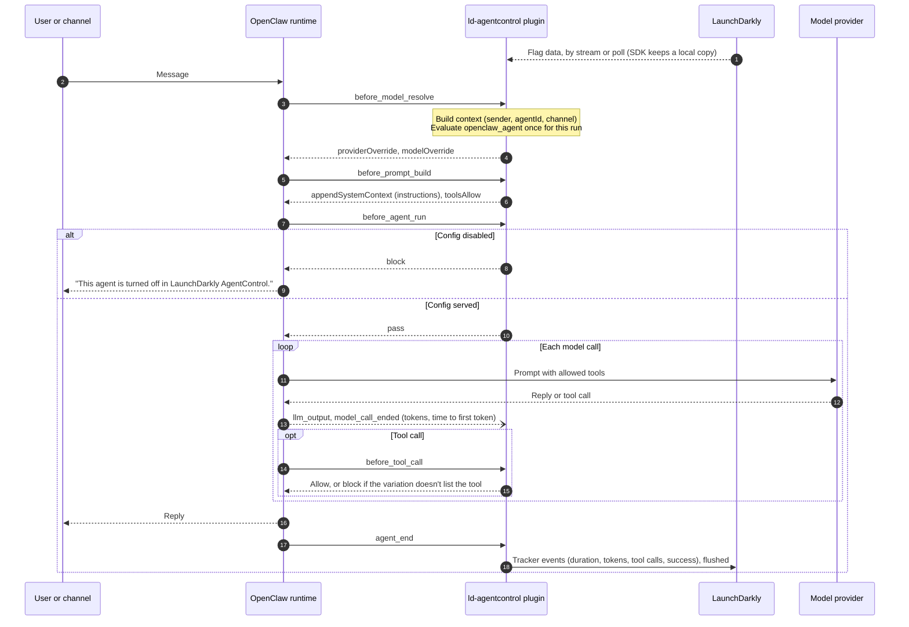

# AgentControl runtime control for OpenClaw agents

An [OpenClaw](https://docs.openclaw.ai) plugin that takes each agent run's model, instructions and tools from a
LaunchDarkly AgentControl config, and records the run's tokens, duration and outcome on that config. Changes made in
LaunchDarkly apply to the next run, with no redeploy and no OpenClaw restart. [PLAN.md](PLAN.md) explains the design
and what was tested.

| File | What it is |
|---|---|
| `plugin/` | The OpenClaw plugin (`index.ts`) and its manifest |
| `setup_config.py` | Creates the `openclaw_agent` config, its tools, variations and targeting. Also the kill switch and instruction edits the checks use |
| `run_checks.sh` | Five checks against real OpenClaw agents and the live config |
| `env.sh` | Exports the variables the checks need from the repo's env file, and points OpenClaw at `.state/` |

## Before you run it

- **Node** 24.16 or later (or 26.1 or later), for OpenClaw.
- **The env file**: `.env.staging-org` at the repo root by default, set with `ENV_FILE_NAME`. It needs
  `LAUNCHDARKLY_SDK_KEY`, `LAUNCHDARKLY_ACCESS_TOKEN`, `LAUNCHDARKLY_PROJECT_KEY`, `LAUNCHDARKLY_ENVIRONMENT` and
  `OPENAI_API_KEY`.
  - For a non-production LaunchDarkly instance, also set `LAUNCHDARKLY_API_HOST`, `LAUNCHDARKLY_BASE_URI`,
    `LAUNCHDARKLY_STREAM_URI` and `LAUNCHDARKLY_EVENTS_URI`.
  - When `LAUNCHDARKLY_BASE_URI` is set, the plugin polls instead of streaming, as the rest of this repo does.
- **The project's model configs** must include `OpenAI.gpt-5.4-mini` and `OpenAI.gpt-5.4-nano`. OpenClaw refuses
  model ids that aren't in its catalog, such as `gpt-4o-mini`.

## Run it

```sh
cd openclaw
npm install
(cd plugin && npm install)
python3 setup_config.py setup   # safe to rerun
./run_checks.sh                 # or one check: baseline, targeting, tools, live, killswitch
```

The first run creates `.state/`, writes an OpenClaw config with two agents (`main` and `helper`), and links the
plugin. OpenClaw never reads or writes `~/.openclaw` here. Every check makes real model calls; a full run is about 10
calls on the two small models.

To talk to an agent yourself:

```sh
source env.sh
npx openclaw agent --local --agent helper -m "What can you do?"
cat .state/decisions.jsonl     # what each run was served, offered and blocked
```

## What it changes in LaunchDarkly

- Two Library tools: `openclaw_read` and `openclaw_exec`. The plugin strips the `openclaw_` prefix to get OpenClaw's
  tool ids.
- An agent-mode config, `openclaw_agent`, with two variations:
  - `standard`: `gpt-5.4-mini` with both tools.
  - `locked-down`: `gpt-5.4-nano` with no tools.
- Targeting in your environment: `locked-down` for contexts whose `agentId` is `helper`, and `standard` for everyone
  else.

`python3 setup_config.py off` is the kill switch. It serves the config's built-in `disabled` variation to everyone,
because the API can't flip an AI Config's targeting toggle. `on` restores the targeting. The UI toggle works too.

## How the plugin maps AgentControl onto OpenClaw

The plugin runs inside the OpenClaw process. The first hook in a run evaluates the config, and later hooks in that
run reuse the result. The SDK evaluates from its local copy of the flags, so a hook doesn't wait on a network call.
Only events go back to LaunchDarkly.



| AgentControl | OpenClaw hook | Effect |
|---|---|---|
| Config off, or the `disabled` variation | `before_agent_run` | The run is blocked with a message |
| Model and provider | `before_model_resolve` | That run's model. `model.custom.openclawModel` (`provider/model`) overrides the mapping |
| Instructions | `before_prompt_build` | Appended to OpenClaw's system prompt |
| Tools | `before_prompt_build`, `before_tool_call` | Other tools are hidden from the model, and any call to one is blocked |
| Tracker | `llm_output`, `model_call_ended`, `agent_end` | Tokens, time to first token, duration, tool calls and success |

The LaunchDarkly context is a `user` keyed by the sender, or `openclaw-local-operator` for command-line runs. It has
the attributes `agentId`, `channel` and `trigger`.

When LaunchDarkly can't be reached, or the config doesn't exist, runs keep OpenClaw's own settings. Set
`failClosed: true` in the plugin's config to block them instead.

Plugin settings go under `plugins.entries.ld-agentcontrol.config` in the OpenClaw config. They are `configKey`,
`toolPrefix`, `failClosed`, `hideTools`, `initTimeoutSeconds` and `decisionLog`; the manifest describes each one.

## Gaps and unexpected behavior

Found on 2026-10-13 while building and testing this, with:

- OpenClaw 2026.10.3 on Node 26.9.0
- `@launchdarkly/server-sdk-ai` 2.0.13 and `@launchdarkly/node-server-sdk` 9.14.4
- the LaunchDarkly REST API with `LD-API-Version: beta`

Recheck these after upgrading any of them.

### LaunchDarkly AI SDK

- **A missing config looks the same as a disabled one.** For an unknown config key, `agentConfig()` returns the
  default, which is `enabled: false`, and doesn't say why. So a wrong key or environment would turn every agent off.
  - Workaround: when a config comes back disabled, the plugin calls the base SDK's `variationDetail()` and treats
    an `ERROR` reason as "LaunchDarkly unavailable".
  - This is the only place the plugin goes outside the AI SDK. It sends one extra evaluation event when it runs.
- **Metrics have to be recorded by hand when the app doesn't make the model call.** `trackMetricsOf` wraps a call
  the app makes itself. OpenClaw makes the calls here.
  - Workaround: the plugin adds up the usage from OpenClaw's `llm_output` hook and calls `trackTokens`,
    `trackDuration` and the other track methods itself.
  - OpenClaw reports cached prompt tokens separately, and the plugin counts them as input. Before that fix, a run
    showed 358 input tokens against a total of 27,888.

### LaunchDarkly REST API

- **There's no API instruction to turn an AI Config's targeting on or off.** `turnFlagOn` and `turnFlagOff` return
  HTTP 400, `invalid instruction`. The targeting API's documented instructions don't include a toggle; only the UI
  has one.
  - Workaround: `setup_config.py off` serves the built-in `disabled` variation from the default rule and every
    targeting rule. `on` puts them back.
- **The AI Configs targeting view leaves out each rule's ID and variation.** `GET /ai-configs/{key}/targeting`
  returns a rule's clauses only. So a script can't tell what a rule serves, or remove or update it.
  - Workaround: read the rules from the config's flag (`GET /api/v2/flags/{project}/{key}`). Reads work there;
    writes to an AI Config's flag are refused.

### LaunchDarkly flag delivery: streaming and polling

This cost the most debugging time. Streaming is the SDK's default, and it served stale data on the non-production
LaunchDarkly instance used for testing.

**What we saw.** `setup_config.py` moved the locked-down rule from `agentId` `restricted` to `helper`. The API
showed the new rule, but the next `helper` run was still served `standard`.

**How we found it.**
- A fresh SDK client using the stream evaluated `helper` against the old rule.
- A fresh client with `stream: false` evaluated it against the new rule.
- The stream was still stale on a recheck about two minutes after the edit, while polling had it at once.
- Every client was new, so nothing was cached in the plugin.

**Earlier symptom, probably the same cause.** Just after `openclaw_agent` was created, the first run logged
`Unknown feature flag "openclaw_agent"` and was treated as turned off. A run about a minute later found the config.

**What we changed.** When `LAUNCHDARKLY_BASE_URI`, the SDK polling host, is set, the plugin polls instead of
streaming. This matches this repo's skills demo, which hit the same thing; see `skills/README.md`.

**What polling costs.**
- A one-shot `openclaw agent --local` run starts a new client, which fetches current flags at start. It sees an edit
  on its next run, and the checks pass either way.
- A long-running Gateway keeps one client. It polls every 30 seconds by default, so an edit can take up to 30
  seconds to arrive. With a working stream it would take seconds.
- Polling makes a request every interval, where streaming holds one connection.

**What to check.** Leave `LAUNCHDARKLY_BASE_URI` unset on an instance whose stream picks up edits; the plugin then
streams. To find out, edit a variation and evaluate it from a new streaming client and a new polling client. The
`check_live` check in `run_checks.sh` retries for about a minute in case changes are slow to arrive.

### OpenClaw

- **Only models in OpenClaw's catalog are accepted.** `openai/gpt-4o-mini` was rejected as a "retired or
  noncanonical model ref". A variation's model has to be one both the LaunchDarkly project and OpenClaw's catalog
  know, such as `gpt-5.4-mini`.
- **The agent id changes how the agent behaves.** OpenClaw puts the agent id in the system prompt. An agent called
  `restricted` refused to use tools that were offered, so a check couldn't tell whether the plugin had blocked them.
  - Workaround: the agents have neutral names (`main`, `helper`).
- **Session history carries over between runs.** `openclaw agent --local --agent <id>` reuses that agent's main
  session, so earlier refusals affected later runs.
  - Workaround: each check passes a new `--session-key`.
- **Hooks can't set sampling settings for a run.** Temperature, max tokens and similar settings live in OpenClaw's
  config, per agent or per model, not per user. A variation's `model.parameters` are not applied.
- **Hook support differs between runners.** This is from OpenClaw's docs and wasn't tested; only the embedded
  runner was.
  - The Codex app-server runner rejects a restrictive `toolsAllow`.
  - The cloud Agents API runner ignores `toolsAllow`.
  - `before_agent_run` isn't a reliable gate on the Codex or Copilot runners.
  - Where tools can't be hidden, `before_tool_call` is the check that blocks them.
- **Setup details:**
  - `agent exec` has no `--agent` flag, so the checks use `openclaw agent --local`.
  - A config with more than one agent needs `agents.ownership: "explicit"`.
  - Installing a local plugin needs `--accept-capabilities`.
  - A project-local `npm install` refuses `--allow-scripts`, so `package.json` uses an `allowScripts` field instead.
